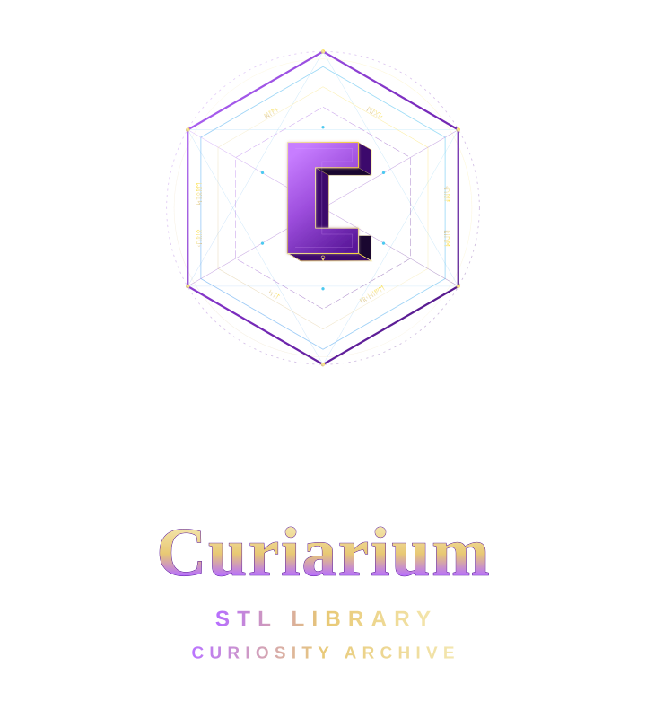

<p align="center">
  
</p>

<p align="center">
  <em>A self-hosted vault for 3D print files, models and the references that go with them.</em>
</p>

<p align="center">
  
  
  
  
</p>

---

Curiarium is a private, self-hosted home for a 3D-printing library: browse STLs, STEP and
3MF in the browser, organise them in folders that are real directories, group anything
into **projects**, hand files straight to your slicer, and let the thing protect itself
with a trash, filesystem snapshots and a full audit trail.

It is built for one household — a few people sharing a printer or two — rather than for
publishing.

## What it does

**Library and storage**

| | |
|---|---|
| **Folders are directories** | A folder *is* a directory under the storage root. Create, rename, move and delete in the UI and the filesystem follows; `DELETE` moves the subtree to trash, never unlinks blind. |
| **Rescan for files you copied in** | `rsync`/`cp` files into the storage root, press **Rescan storage folder**, and they are registered where they already sit — no import dance, no re-templating. |
| **Nothing disappears quietly** | A file removed behind the app's back is flagged *missing* (with a date) rather than vanishing from the library. Reference imports whose source is gone are flagged too, never deleted. |
| **Storage template** | New files land in a configurable layout (`{folder}/{model}/{filename}` by default). Files are only ever moved by an explicit rename or folder move — retagging does not rearrange your disk. |

**Organisation**

| | |
|---|---|
| **Folders, tags, notes** | Tree folders, free-form tags, per-asset notes, creator/collection facets, sorting and search. |
| **Projects** | A project is a named collection of arbitrary assets from anywhere in the library. An asset can be in none, one or many. Project pages carry a rendered markdown description, a gallery, licence/provenance and a print-settings block, with the files underneath. |
| **Bulk operations** | Select many, then tag, move, delete or download as one request with per-item failure reporting. |
| **Two browse modes** | *Files* (folder browser) and *Projects* (collections), persisted per browser. |

**Preview and inspection**

| | |
|---|---|
| **3D previews** | STL, OBJ, STEP/STP and 3MF render in the browser; STEP runs in a session-long worker with abort, so a heavy file cannot freeze the library. |
| **Cached thumbnails** | Generated only as cards approach the viewport (or on demand, or off — your choice), then saved server-side so other browsers skip the work. |
| **LightBurn** | `.lbrn`/`.lbrn2` previews with layer colours and per-layer toggles, parsed off the main thread with a size guard. |
| **Prepared-print summaries** | Printer, material, nozzle and estimated time read out of 3MF or an attached print file. |
| **Supporting files** | Attach PDFs, notes, whatever, per model — renamable, reorderable, previewable, included in ZIPs, with size and count limits. |

**Safety**

| | |
|---|---|
| **Trash** | Folder and asset deletes move bytes to `.trash`; purge is a separate, explicit action. Restore is copy-back from the trash or a snapshot, then rescan. |
| **Filesystem snapshots** | If the storage volume supports them (CephFS `.snap`, ZFS via delegated rights, BTRFS via an opt-in privileged sidecar) Curiarium takes a snapshot before destructive operations, keeps a retention window, and exposes browse/restore. Your database is *not* covered unless it lives on a snapshottable volume. |
| **Audit log** | Every destructive or administrative action is recorded in an append-only table enforced by database triggers, with request ids. |
| **Signed file URLs** | File links carry short-lived, file-scoped grants signed separately from the session token. Session tokens are never accepted in a URL, and neither nginx log records query strings. |

**Access**

| | |
|---|---|
| **Users and roles** | Local accounts (argon2id) with `admin` / `editor` / `viewer`, enforced by a per-route permission matrix that refuses to boot if a route is unclassified. |
| **OIDC single sign-on** | Authorization Code + PKCE, `state`/`nonce` validated, identity bound to a unique `(issuer, subject)`, allow-lists that compose with AND. Claims can grant at most `editor` — **OIDC can never mint an admin**. |
| **MFA** | TOTP enrolment with recovery codes, and a policy that can require MFA for admins. |
| **Sessions** | List your sessions (device, IP, last seen), revoke any of them; revocation is immediate because the access token is bound to a live session row. Multi-tab refresh uses a grace window and treats replays as a compromise signal. |
| **Throttling and headers** | Per-username login backoff, plus HSTS/CSP/`X-Content-Type-Options`/`Referrer-Policy`/`Permissions-Policy`/frame policy from the web container, all configurable. |

**Getting files in and out**

| | |
|---|---|
| **Uploads** | Drag, drop, pick files or a whole folder; a bounded queue with per-file progress, retry and cancel; bodies are streamed to the storage path (no `/tmp` double-write), default cap 4 GB. |
| **Link imports** | MakerWorld, Printables and Thingiverse: public page and public downloads only, with SSRF-hardened, IP-pinned fetching. Account-gated content is yours to supply, by design. |
| **Mounted-library import** | Point at a directory, choose copy or reference mode, and watch a run history with counts, per-file errors and interruption status. |
| **ZIP in and out** | Inspect a ZIP before importing, keep only what you want; download a selection, a folder or a project with an `ATTRIBUTION.txt` naming source, creator and licence. |
| **Open in Slicer** | A small Go bridge registers `curiarium-slicer://` and `curiarium-engrave://` handlers so the browser can hand a file to the slicer installed on your own machine. |

## Quick start

Images are published to GHCR on every push to `main` — no local build, no clone.

```bash
git clone --depth 1 https://github.com/insanemal/curiarium.git
cd curiarium/curiarium
cp api/.env.example .env      # then edit the marked lines
docker compose -f docker-compose.deploy.yml up -d
```

Open <http://localhost:5173>.

### Setting up the .env file

Copy `curiarium/api/.env.example` to `curiarium/.env` and edit the marked lines. A
working baseline:

```yaml
PUID=1000
PGID=1000
API_IMAGE=ghcr.io/insanemal/curiarium-api:edge
WEB_IMAGE=ghcr.io/insanemal/curiarium-web:edge
FILE_STORAGE=/app/storage
DB_URL=sqlite:////app/data/app.db
API_PORT=8000
WEB_PORT=5173
PUBLIC_URL=
CORS_ORIGINS=
VITE_API_URL=
VITE_ALLOWED_HOSTS=
AUTH_USERNAME=admin
AUTH_PASSWORD=replace-with-a-strong-password
AUTH_SECRET=replace-with-a-long-random-string
AUTH_ACCESS_TOKEN_TTL=900
AUTH_REFRESH_TTL_SECONDS=2592000
MAX_UPLOAD_MB=4096
IMPORT_MOUNT_PATH=/imports
IMPORT_MOUNT_EXTS=stl,3mf,step,stp,obj,svg,png,jpg,jpeg,webp,bmp,lbrn,lbrn2,zip
IMPORT_MOUNT_ON_STARTUP=false
```

`PUID`/`PGID` make the containers run as your user so the mounted volumes stay
writable. `PUBLIC_URL` is the only value that matters behind a reverse proxy; leave
`VITE_API_URL` empty there. The full inventory, including OIDC and snapshot knobs, is in
[CONFIGURATION.md](curiarium/docs/architecture/CONFIGURATION.md).


Image tags: `edge` (tip of `main`), `sha-<short>` (pin this for reproducible
deploys), and semver tags from `v*` git tags. Pin a `sha-` tag if you want an
upgrade to be a decision rather than a side effect.

**First login.** Three ways in, in priority order:

1. **Local users** — create them in Settings → Users, or via `POST /users` as an admin.
2. **OIDC** — set `OIDC_ENABLED` and friends; see [CONFIGURATION.md](curiarium/docs/architecture/CONFIGURATION.md).
3. **Break-glass** — `AUTH_USERNAME` / `AUTH_PASSWORD` from the environment work **only while
   the users table is empty**. Create a user and they stop working; that is deliberate.

The API refuses to start with the published sample credentials (`super-secret` /
`changeme-secret`) unless you explicitly set `AUTH_ALLOW_INSECURE_DEFAULTS=1`.

**Where your data lives**

| Volume | Contents |
|---|---|
| `curiarium_storage` | managed model files, thumbnails, supporting files, `.trash`, `.incoming` staging |
| `curiarium_db` | `curiarium.db` (SQLite) |

Both are named volumes in the deploy manifest; point them anywhere with
`FILE_STORAGE` and `DB_URL`. Putting the **database on a network filesystem is not
supported** — SQLite wants a local disk, and the container relies on WAL.

## Configuration

Everything lives in `.env`; the full inventory with owners and defaults is in
[CONFIGURATION.md](curiarium/docs/architecture/CONFIGURATION.md). The knobs people
actually touch:

| Variable | Default | Meaning |
|---|---|---|
| `PUBLIC_URL` | — | Public origin, e.g. `https://vault.example.com`. The web container derives `<PUBLIC_URL>/api` from it. |
| `CORS_ORIGINS` | — | Comma-separated extra origins for direct/LAN access. |
| `AUTH_USERNAME` / `AUTH_PASSWORD` | — | Break-glass admin, only while no user exists. |
| `AUTH_ACCESS_TOKEN_TTL` | `900` | Access-token lifetime (seconds). Refresh tokens live 30 days and are revocable. |
| `MAX_UPLOAD_MB` | `4096` | Direct upload cap. Your reverse proxy needs a matching body limit. |
| `IMPORT_MAX_MB` / `IMPORT_ZIP_MAX_MB` | `512` / `2048` | Remote import size and cumulative ZIP budget. |
| `ASSET_FILE_MAX_MB` / `_TOTAL_MAX_MB` / `_MAX_COUNT` | see example | Supporting-file limits. |
| `SNAPSHOT_*` | off | Snapshot policy per destructive operation, retention and the optional daily schedule. |

## Behind a reverse proxy

One hostname is enough. Send **all paths** to the web container (port 5173); it serves
the UI and proxies `/api/*` to the API container over the compose network. Set
`PUBLIC_URL` to the public origin and leave `VITE_API_URL` empty. TLS terminates at
your proxy. Details, including the header/body-size requirements, are in
[REVERSE_PROXY.md](curiarium/docs/architecture/REVERSE_PROXY.md).

## Backup, restore, upgrade

Snapshots cover *files*. The database needs its own copy, and an upgrade is only
safe with both. The procedure — snapshot, stop, back up DB + storage, upgrade, verify,
roll back — is in [ARCHITECTURE_RUNBOOK.md](curiarium/docs/ARCHITECTURE_RUNBOOK.md).
Short version: back up `curiarium.db` and the storage volume together, and never
upgrade one without the other.

## Architecture

```
browser ──► web container (nginx :5173) ──/api/*──► api container (FastAPI :8000)
                     │                                       │
                 static bundle                        SQLite (local disk)
                                                      storage root (files, trash,
                                                      thumbs, supporting files)
```

* `curiarium/api` — FastAPI, 18 routers, SQLModel, versioned migrations (currently **13**),
  per-route permission matrix, append-only audit, snapshot providers, import resolvers.
* `curiarium/web` — React 18 + Vite + Tailwind, virtualised grid, single-flight preview
  queue, upload queue, project pages.
* `curiarium/slicer-bridge` — Go protocol handler for slicer handoff (per-machine install).
* `curiarium/scripts` — verification scripts: container smoke, wave planner, version guard.

The design decisions live as ADRs in [`curiarium/docs/adr/`](curiarium/docs/adr/); the
operational detail is in the [architecture runbook](curiarium/docs/ARCHITECTURE_RUNBOOK.md).

## Development

```bash
make verify-fast   # ~90 s: ruff + API tests, eslint + tsc + vitest, go test
make verify        # full gate: images, container smoke, compose validation
```

`make verify-fast` needs a repo-local `.venv` (see
[DEVELOPMENT.md](curiarium/docs/DEVELOPMENT.md)) and `npm ci` once. `make verify` is
the gate that certifies a batch; it must pass before anything is pushed as done.

Start with [AGENTS.md](AGENTS.md) if you are an AI agent or a new contributor — it maps
the repo, the gates and the guardrails in one read. The ticket loop this project is built
with is described in [docs/TICKET_WORKFLOW.md](docs/TICKET_WORKFLOW.md).

## Project status — honestly

Working and tested (API **1841** tests, web **1037**): folders-as-directories, scanning,
trash, projects, snapshots (CephFS/ZFS providers, BTRFS via sidecar), users/roles, OIDC,
MFA, sessions, signed grants, audit, imports, previews, uploads, ZIP in/out, slicer handoff.

Known gaps, so nobody is surprised:

* **Not yet exercised against a real CephFS mount** end-to-end by the test suite; the
  integration test is gated behind `SNAPSHOT_INTEGRATION=1` and is a manual procedure.
* **OIDC admin is intentionally impossible** — an admin must be created locally.
* **No per-user ownership** of assets; it is a shared household library.
* **Slicer bridge binaries are not published** as releases; build from source with Go.
* **Screenshots are missing** from this README until they can be regenerated from the
  current UI (the old ones were upstream's and are gone).
* Dependency majors (Tailwind 4, React 19, vite 7) are deliberately deferred.

## Licence and attribution

MIT. Curiarium is a fork of [MakersVault](https://github.com/GhostLabs-ent/MakersVault)
by VincentCinque and GhostLabs-ent; their copyright notice is retained in
[LICENSE](LICENSE) and the fork relationship, rework summary and trademark position are
recorded in [NOTICE](NOTICE). Upstream work is ported by hand, one change at a time —
the two trees diverged deliberately and are not merged.
