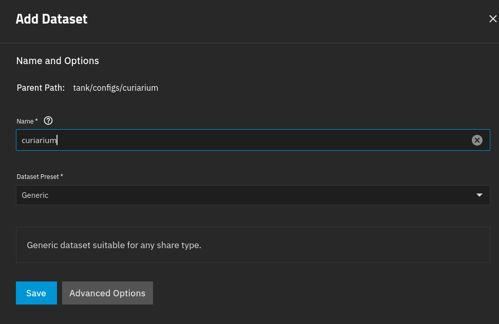
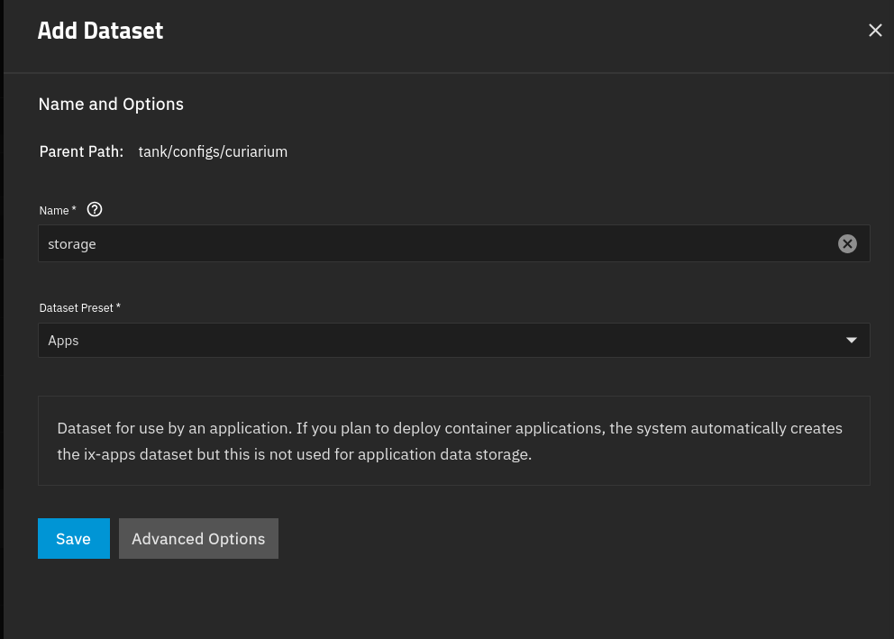
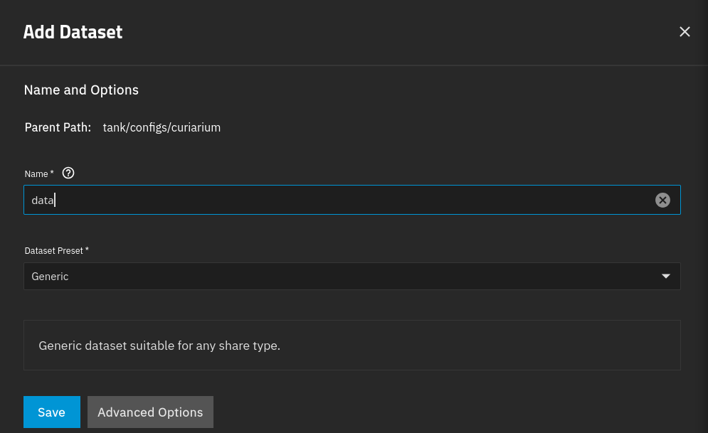
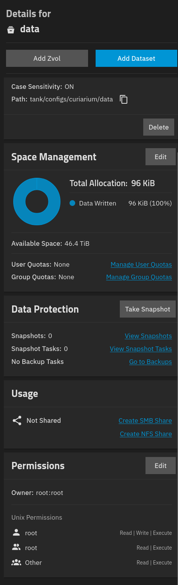
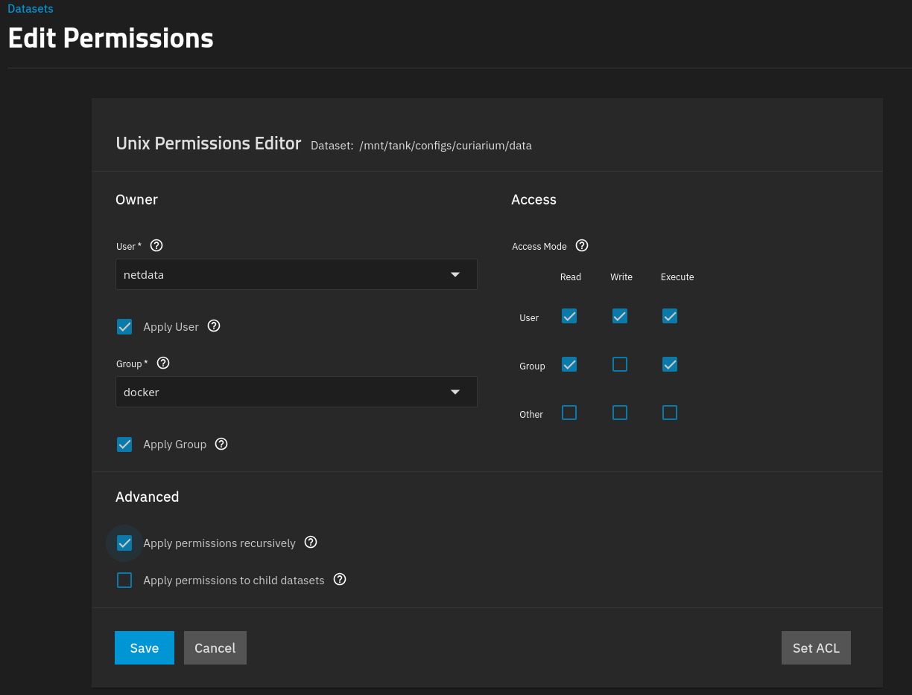
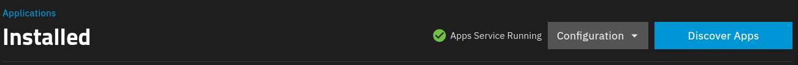
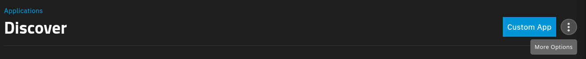
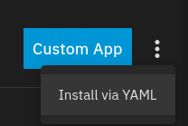
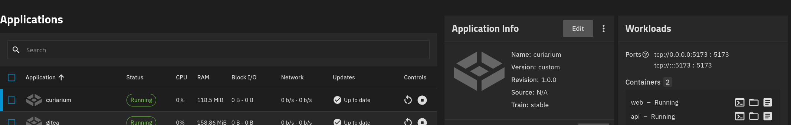
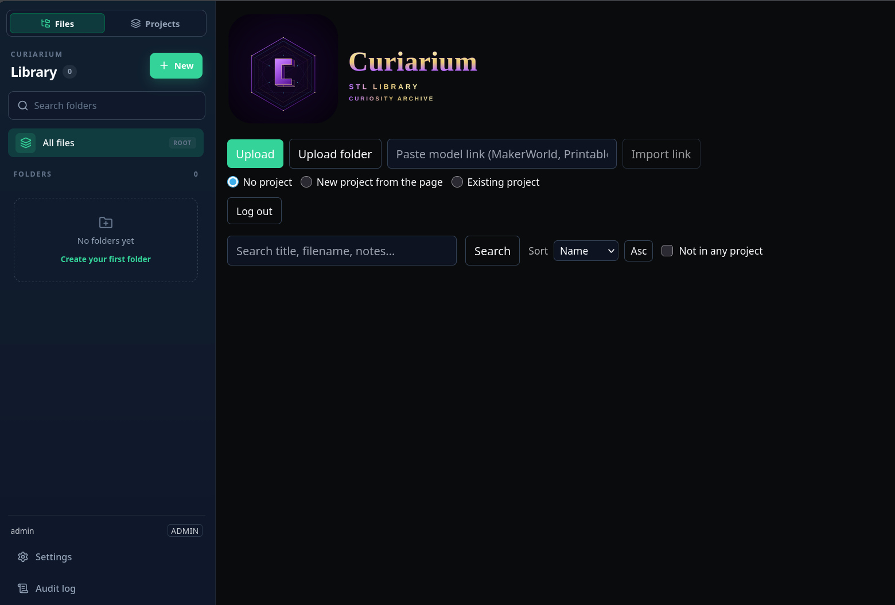

# TrueNAS Installation Guide

Tested on TrueNAS 27.0.0-RC.1 , 

Apps run as a built-in non-root account called `apps`, which has UID 568 and GID 568.

```bash
truenas_admin@backup[~]$ getent passwd 568
apps:x:568:568:Unprivileged Apps User:/var/empty:/usr/sbin/nologin
truenas_admin@backup[~]$ getent group 568
apps:x:568:
```

For the sake of this guide, Curiarium will use datasets within `/mnt/tank/configs` on a ZFS pool called `tank`.

## ZFS Datasets

Step 1. Create a dataset called `curiarium` with the parent path `tank/configs` (giving `tank/configs/curiarium`). Set the preset to `Generic`.



Step 2. Add a dataset called `storage` to the `curiarium` dataset from Step 1, using the `Apps` preset.



Step 3. Add a dataset called `data` to the `curiarium` dataset from Step 1, using the `Generic` preset.



Step 4. Open the Permissions tab for the `data` dataset and select `Edit`.



Set the following permissions:

- User = `apps`
- Group = `apps`
- Untick the Other read/write permissions
- Tick `Apply permissions recursively`

Then select `Save`.



## Setup Environment

Create the `.env` file. Change `PUBLIC_URL=` to suit your setup.

`PUBLIC_URL` uses HTTPS in this example, but the app itself serves plain HTTP on port 5173. For an HTTPS URL you need a reverse proxy that terminates TLS and forwards all paths to port 5173. If you only access Curiarium on your LAN over HTTP, leave `PUBLIC_URL` empty and use `CORS_ORIGINS` instead.

**Optional:** `CORS_ORIGINS` is a comma-separated list of web addresses that the API will allow to call it from a browser.

**Background.** Browsers enforce the same-origin policy. A page loaded from one origin (scheme, host and port together) cannot read responses from a different origin unless that server says it is allowed, using CORS headers. This means `http://curiarium.example.com:5173` and `http://IP:5173` are different origins, even though they reach the same server.

```bash
sudo tee /mnt/tank/configs/curiarium/.env >/dev/null <<EOF
PUID=568
PGID=568
CHOWN_MODE=minimal
FILE_STORAGE=/app/storage
DB_URL=sqlite:////app/data/curiarium.db
PUBLIC_URL=https://curiarium.example.com
# CORS_ORIGINS=http://curiarium.example.com:5173,http://IP:5173
VITE_API_URL=
AUTH_MODE=auto
AUTH_USERNAME=admin
AUTH_PASSWORD=change-me-to-something-strong
AUTH_SECRET=$(openssl rand -hex 32)
AUTH_ACCESS_TOKEN_TTL=900
AUTH_REFRESH_TTL_SECONDS=2592000
MAX_UPLOAD_MB=4096
EOF
```

If your password contains `$` or a backtick, the shell will expand it inside this heredoc. Edit the file afterwards, or quote the delimiter (`<<'EOF'`) and paste a pre-generated secret instead of using `$(openssl ...)`.

Set the file to mode `600`, owned by `apps:apps`:

```bash
sudo chown 568:568 /mnt/tank/configs/curiarium/.env
sudo chmod 600 /mnt/tank/configs/curiarium/.env
```

## Install App

Select `Discover Apps`.



Select `More Options`.



Select `Install via YAML`.



In the name field enter `curiarium`, then paste the following into the `Custom Config` field:

```yaml
services:
  api:
    container_name: c_api
    devices:
      - /dev/zfs:/dev/zfs
    env_file:
      - /mnt/tank/configs/curiarium/.env
    image:  ghcr.io/insanemal/curiarium-api:edge-zfs
    restart: unless-stopped
    volumes:
      - bind:
          propagation: rslave
        source: /mnt/tank/configs/curiarium/storage
        target: /app/storage
        type: bind
      - /mnt/tank/configs/curiarium/data:/app/data
  web:
    container_name: curiarium_web
    depends_on:
      - api
    env_file:
      - /mnt/tank/configs/curiarium/.env
    image: ghcr.io/insanemal/curiarium-web:edge
    ports:
      - '5173:5173'
    restart: unless-stopped

```

### Application Running within Truenas



### Main Login 


